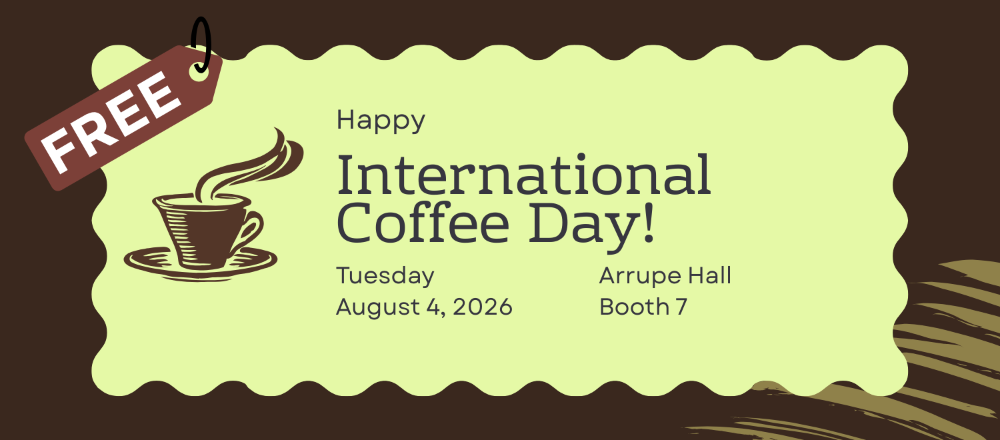

  

 

☕ Activity 1: International Coffee Day Poster

𖠿 Overview

For this activity, I created a promotional poster for International Coffee Day. The goal was to design something visually appealing that could catch people’s attention while clearly showing the important details of the event.

✧ Design Concept

I chose coffee as the main theme because it is often associated with comfort, energy, relaxation, and connection. I wanted the poster to have a warm and welcoming look that would encourage students to join the event.

The main highlight of the design is the large “FREE COFFEE” text, which serves as the first thing viewers notice and helps communicate the main offer right away.

☕ Design Elements

Element	Description
Theme	International Coffee Day
Main Visual	Coffee
Main Text	FREE COFFEE
Color Palette	Warm brown and coffee-inspired tones
Typography	Clear and eye-catching fonts
Layout	Organized placement of text and visuals for easy reading

✧ Purpose

The poster was created to promote the International Coffee Day event, attract attention, and encourage students to participate.

☕ What I Learned

Through this activity, I learned that creating an effective poster is not just about making it look good. It is also important to present information clearly and make sure that the design elements work together. Colors, typography, images, and layout all help communicate the message and make the poster more appealing.

⸻

Good design catches attention, but clear messages make it meaningful.

♡ Create • Design • Communicate ♡

