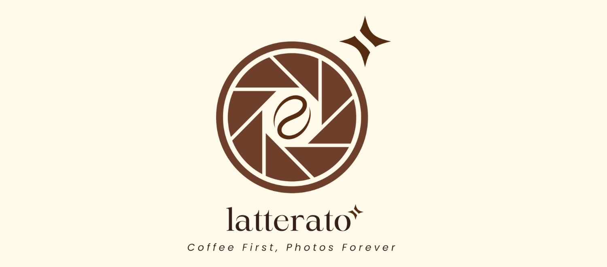

  

 

☕📸 Activity 2: Latterato Brand Identity

𖠿 Overview

For this activity, I created a coffee shop brand concept called Latterato, with the tagline:

“Coffee First, Photos Forever.”

Latterato is more than just a coffee shop. It is a place where people can enjoy coffee, spend time with friends, create memories, and capture special moments through a photobooth.

✧ Brand Concept

The concept behind Latterato combines two experiences:

☕ Enjoying Coffee + 📸 Preserving Memories

The coffee shop offers a comfortable and welcoming space where customers can relax and connect with others. The photobooth adds a fun experience where customers can take pictures and bring home memories of their visit.

The tagline “Coffee First, Photos Forever” represents the idea of enjoying a cup of coffee while creating moments worth remembering.

☕ Logo Concept

The Latterato logo combines coffee and photography elements to represent the two main experiences of the brand.

The coffee element represents the shop’s main product, while the photography element represents the photobooth and the memories customers can capture.

🎨 Color Palette

I used different shades of brown to create a warm, cozy, and coffee-inspired visual identity.

Color	Hex Code
■ Brown	#6D3E29
■ Deep Brown	#572D12
■ Coffee Brown	#562C11
■ Dark Brown	#361F1A

These colors reflect the warmth and richness commonly associated with coffee.

✧ Typography

The brand uses two typefaces:

* Poppins – for a modern and clean appearance.
* Maharlika – to add an elegant and distinctive character.

Their combination gives the brand a balance of modern and elegant elements.

📸 Brand Experience

Latterato is designed to offer:

* ☕ Coffee and other beverages
* 📸 A photobooth experience
* 🧑‍🤝‍🧑 A space for friends and conversations
* 🛋️ A cozy and welcoming environment
* 📷 Photos and memories customers can take home

✧ Purpose

The purpose of this brand identity is to create a recognizable coffee shop concept that focuses not only on the products but also on the experience and memories customers can associate with the brand.

☕ What I Learned

Through this activity, I learned that branding is more than just creating a logo. A strong brand should communicate its personality, purpose, and experience through its colors, typography, visuals, and overall identity.

For Latterato, I wanted to create a coffee shop concept that offers more than just coffee. It is a place where people can enjoy their time together and have something to remember their visit by.

“Coffee creates the moment, and the photobooth helps preserve it.”

⸻

Coffee First, Photos Forever.

♡ Sip • Smile • Capture • Remember ♡

