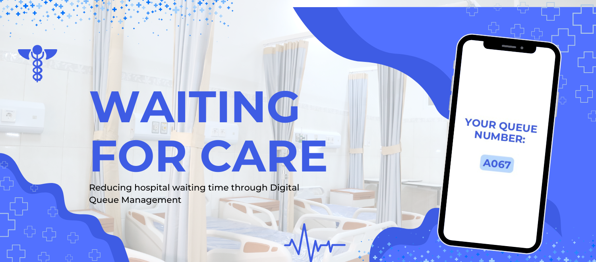

  

 

🏥 Activity 3: Waiting for Care Infographic

𖠿 Overview

For this activity, I created a healthcare-related infographic titled:

“Waiting for Care: Reducing Hospital Waiting Time Through Digital Queue Management”

The infographic focuses on the problem of long waiting times in healthcare facilities and presents a possible technological solution through a Digital Queue Management System.

✧ The Problem

Long waiting times in healthcare facilities can lead to several challenges, such as:

* Patient dissatisfaction
* Delayed access to healthcare services
* Crowded waiting areas
* Increased workload for healthcare workers
* Frustration among both patients and staff

These challenges made me explore how technology could help make the waiting process more organized and efficient.

💡 Proposed Solution

The infographic presents a Digital Queue Management System that allows patients to:

1. Register digitally
2. Receive a queue number
3. Monitor their queue position
4. Receive notifications
5. Proceed when it is their turn

The system aims to minimize unnecessary waiting and help patients stay informed about their queue status.

🎨 Design Approach

Since the topic is healthcare-related, I focused on clarity, simplicity, and organization to make the information easy to understand.

The infographic uses:

* Icons to represent the different steps
* Organized sections to separate key information
* Step-by-step visuals to explain the proposed process
* Clear typography for readability
* Simple information hierarchy to guide the viewer

These design elements help make the infographic understandable even for people without technical knowledge.

✧ Purpose

The purpose of this infographic is to show how technology and visual communication can help address a real-world healthcare problem.

Instead of simply presenting the issue, the infographic introduces a possible solution in a way that is easy to understand and follow.

🏥 What I Learned

Through this activity, I learned that design is not only about making something visually appealing. It can also be used for communication, problem-solving, and innovation.

As a nursing student, this activity also helped me see how technology can potentially improve healthcare experiences by making processes more organized, efficient, and patient-friendly.

Good design does not only inform; it can also help solve problems.

⸻

Using technology to make healthcare more organized and accessible.

♡ Design • Communicate • Innovate ♡

