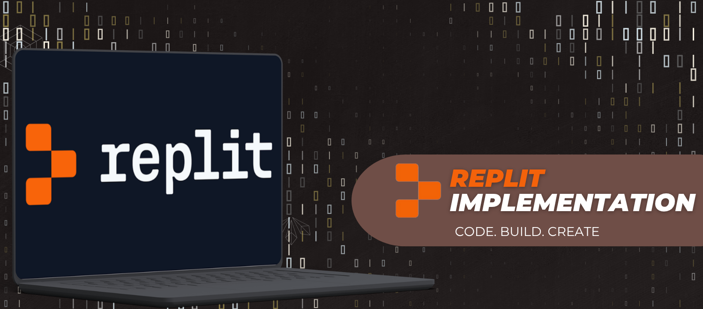

  

 

💻 Activity 5: Replit Implementation

𖠿 Overview

For this activity, I explored Replit, an online platform that allows users to write, run, and develop code directly in a web browser.

The activity introduced me to website development and gave me the opportunity to apply what I learned by working on a website project.

✧ Exploring Replit

I used Replit to become familiar with its workspace and coding environment. Through the platform, I explored how code is written, edited, and executed to create a working website.

This activity also allowed me to experience how different parts of a website come together to form a complete digital output.

💻 What I Did

1. Explored the Platform – Became familiar with Replit and its coding workspace.
2. Worked on the Website – Used the platform to implement a website.
3. Reviewed the Output – Observed how changes in the code affected the website.
4. Made Adjustments – Worked on improving the website during implementation.
5. Applied What I Learned – Used the activity as an opportunity to practice website development.

✧ Purpose

The purpose of this activity was to introduce the use of online coding tools and demonstrate how technology can be used to develop websites.

It also allowed me to explore a different way of creating digital projects beyond traditional document and presentation tools.

✧ What I Learned

Through this activity, I learned that website development involves more than just writing code. It also requires patience, creativity, problem-solving, and attention to detail.

As someone who was still exploring website development, using Replit gave me the opportunity to become more familiar with coding and understand how ideas can be turned into actual websites.

Every digital project starts with an idea and the willingness to explore.

⸻

Explore • Code • Create

♡ Turning ideas into digital projects ♡

