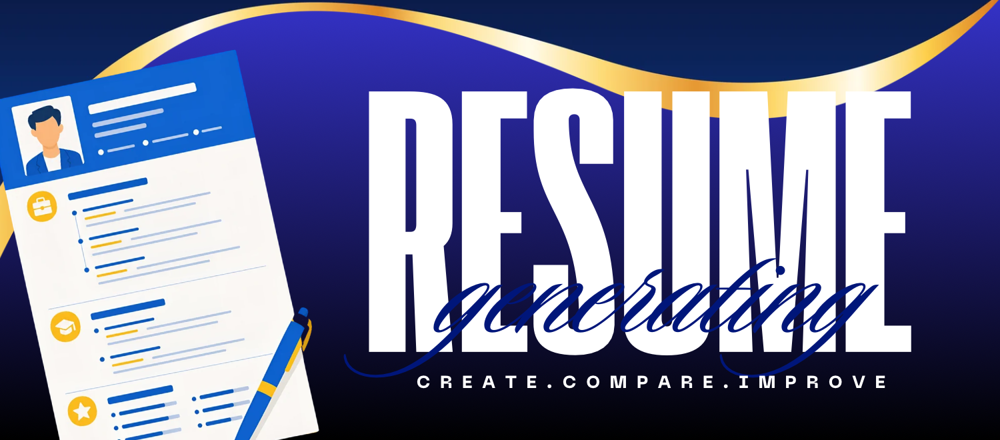

  

 

📄 Activity 7: Resume Generating

𖠿 Overview

For this activity, I explored how Large Language Models (LLMs) can help create professional resumes using personal information, educational background, skills, and clinical experiences.

I used ChatGPT and Claude AI to generate a one-page professional resume targeting an Operating Room (OR) Staff Nurse position. After generating the resumes, I compared their outputs based on structure, clarity, formatting, and overall quality.

✧ Objective

The objective of this activity was to explore how AI tools can assist in creating professional documents and determine how different LLMs present the same information in a resume.

🤖 AI Tools Used

The two AI tools used for this activity were:

* ChatGPT – Used to generate a professional resume based on the provided personal and nursing-related information.
* Claude AI – Used to generate another resume using the same information for comparison.

✧ Resume Content

The prompt included the following information:

* Professional summary
* Educational background
* Clinical nursing experience
* Areas of clinical exposure
* Technical skills and competencies
* Training and certifications

The resume was prepared for an OR Staff Nurse position, highlighting relevant clinical experiences and nursing skills.

📊 Comparison of AI-Generated Resumes

After generating the resumes, I compared the outputs using four criteria:

Criteria	ChatGPT	Claude AI
Structure	Used a formal resume structure with sections such as Professional Summary, Education, Clinical Nursing Experience, Clinical Areas of Exposure, Technical Skills, and Training & Certifications.	Organized the resume into clear sections, including Summary, Education, Clinical Experience, Areas of Exposure, Skills, and Training and Certifications.
Clarity	Provided a more detailed summary and emphasized OR and outpatient surgery experience.	Presented clear and concise descriptions of nursing skills and experiences.
Formatting	Had a more formal layout with bold headings, bullet points, and better spacing between sections.	Had a simple and clean layout, but appeared more compact with less visual separation between sections.
Overall Quality	Produced a more polished and professional-looking resume suited for an OR Staff Nurse application.	Produced a neat and readable resume that included the applicant’s nursing qualifications and clinical skills.

✧ Final Output

After comparing both generated resumes, I selected the ChatGPT-generated resume as my final output because of its more formal presentation, organized sections, and emphasis on clinical experience relevant to the target position.

The final resume presents my educational background, clinical nursing experience, areas of exposure, technical skills, and training in a professional format.

📄 What I Learned

Using Claude AI and ChatGPT helped me see how different LLMs can create a professional resume using the same information. Both tools provided clear and organized outputs, but I noticed that ChatGPT had a more formal layout and emphasized my clinical experience related to the Operating Room. Claude AI, on the other hand, created a simple and compact resume that was easy to read.

Through this activity, I learned that LLMs can be helpful in improving and organizing professional documents. However, I still need to review their outputs to ensure that the information is accurate and reflects my actual qualifications.

AI can help present your qualifications, but reviewing the output makes sure it truly represents you.

⸻

Create • Compare • Improve

♡ Building a professional future with the help of technology ♡

