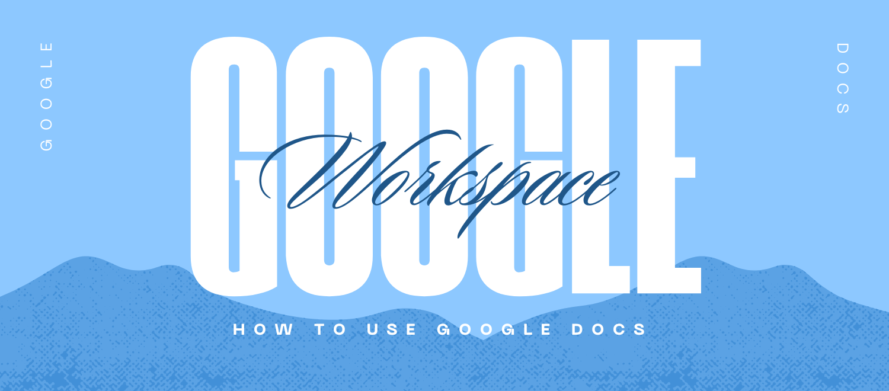

  

 

📄 Activity 6: Midterm Presentation – Google Workspace: How to Use Google Docs

𖠿 Overview

For our midterm presentation, Group 5 discussed Google Docs, a web-based word-processing application developed by Google.

The presentation introduced its main features, tools, and practical applications in school, at home, at work, and in small businesses.

It also included a live demonstration and an interactive activity called “Live Google Docs Race”, which allowed participants to practice using Google Docs and experience real-time collaboration.

✧ Presentation Objectives

The presentation aimed to:

* Understand what Google Docs is and how it works.
* Explore its different features and tools.
* Learn how to create, edit, format, and share documents.
* Understand collaboration features and sharing permissions.
* Identify its practical applications in everyday activities.
* Apply the lessons through a demonstration and interactive activity.

📄 Topics Discussed

The presentation covered the following topics:

1. Introduction to Google Docs
2. Creating and editing documents
3. Real-time collaboration
4. Sharing and document permissions
5. Comments and Suggesting mode
6. Version history and automatic saving
7. Templates and formatting tools
8. Adding tables, images, links, and drawings
9. Voice typing
10. Downloading and exporting documents
11. Practical applications of Google Docs
12. Live demonstration and interactive activity

✧ Practical Applications

Google Docs can be used in different areas of everyday life:

Setting	Examples of Use
School	Group projects, assignments, essays, lecture notes, study guides, and thesis drafts
Home / Personal	To-do lists, journals, trip itineraries, event planning, and shopping lists
Work	Meeting agendas, reports, proposals, project plans, and standard operating procedures
Small Businesses	Business plans, client proposals, flyers, product descriptions, and process guides

🎯 Interactive Activity: Live Google Docs Race

To make the presentation more engaging, we prepared an interactive activity called “Live Google Docs Race.”

Participants were divided into groups and asked to work together using a shared Google Docs document. Each group had to complete five assigned tasks as quickly and correctly as possible.

Activity Instructions

1. Form the assigned groups.
2. Open the provided Google Docs link.
3. Work together to complete the five tasks.
4. Avoid deleting or changing the work of other groups.
5. Raise your hand once all tasks are completed.

The first team to correctly complete all five tasks would win the activity.

This activity allowed participants to experience how Google Docs supports teamwork and real-time document collaboration.

✧ Group Members

Group 5

* Maningo
* Mantalaba
* Modequillo
* Montero
* Naquimen
* Narciso
* Oraiz
* Samsurin
* Panague

✧ Purpose

The purpose of this presentation was to introduce Google Docs as a useful tool for creating, editing, organizing, and sharing documents.

Through the discussion, demonstration, and interactive activity, we aimed to show how it can be used in different settings and how its collaboration features can make working with others easier.

📄 What I Learned

Through this group presentation, I learned more about the different features of Google Docs and how it can be used beyond simply typing and editing documents.

I also realized how useful real-time collaboration can be, especially when working on group activities and school requirements. Preparing the presentation and interactive activity helped me understand the application better while also giving us the opportunity to share what we learned with others.

Technology makes creating and working together easier when we know how to use it effectively.

⸻

Create • Collaborate • Communicate

♡ Working smarter, together ♡

