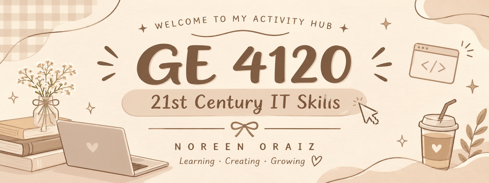

 

𓂃 

  

 

21st Century IT Skills

A collection of learning, creativity, and digital exploration.

✦ ─────────────── ✦

NOREEN ORAIZ
GE 4120 Activity Hub

⸻

𖠿 About This Repository

Hi! I’m Noreen Oraiz, 22 years old.

Welcome to my GE 4120 – Elective: 21st Century IT Skills activity hub! This repository contains the activities and outputs I completed throughout the course, showcasing my learning and creativity in the digital world.

✧ Course Activities

01. Presentation Design Principles

Exploring the basic principles of creating effective and visually appealing presentations. This activity helped me understand how design, layout, colors, fonts, and visual elements improve the way information is presented.

02. Personal Branding

Developing and presenting my personal brand by identifying my strengths, personality, and skills, and learning how to communicate my identity effectively through digital platforms.

03. Social Media Infographic

Creating an infographic designed for social media by combining information, visuals, colors, and design principles to communicate a message in a simple and engaging way.

⸻

☕ A Little About Me

	
Name	Noreen Oraiz
Age	22 years old
Course	GE 4120 – 21st Century IT Skills
Repository	Activity Hub

⸻

Thank you for stopping by!

♡ Learning • Creating • Growing ♡

